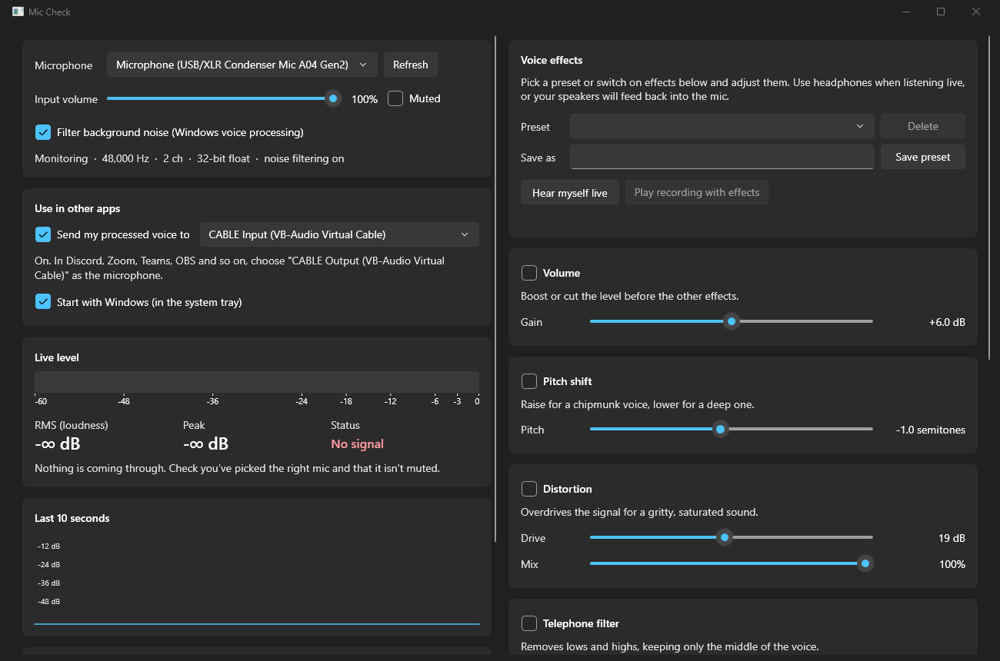

# Mic Check

A Windows desktop app for testing your microphone, seeing your voice levels live, filtering out background noise, and running your voice through effects, both for yourself and for other apps like Discord, Zoom, Teams and OBS.

Built with WPF on .NET 10 and [NAudio](https://github.com/naudio/NAudio).



## Features

- **Microphone test:** pick any input device, adjust its Windows input volume and mute, and see the capture format.
- **Live level meter:** RMS (loudness) and peak in dBFS, a peak-hold marker, a clipping warning, and a plain-English verdict ("No signal", "A bit quiet", "Good level", "Loud", …) with a tip for fixing it.
- **10-second level history:** a scrolling graph so you can see how your level changes as you speak.
- **Record and play back:** record a 5-second clip and hear exactly how you sound.
- **Background noise filtering:** uses Windows' built-in voice processing (Voice Clarity on Windows 11) to remove keyboard typing, mouse clicks and other background noise.
- **Voice effects:** seven adjustable effects (Volume, Pitch shift, Distortion, Telephone filter, Robot, Echo and Reverb) with nine built-in presets, plus presets you save yourself.
  - Hear the effects live through your headphones, or apply them to your recording.
- **Virtual microphone:** send your processed voice (noise filter plus effects) to [VB-CABLE](https://vb-audio.com/Cable/) so any other app can use it as its microphone.
- **System tray:** keeps running in the tray while routing your voice, can start with Windows, reconnects automatically if a device is unplugged, and remembers your settings.

## Requirements

- Windows 10 or 11 (x64). Voice Clarity noise filtering needs a recent Windows 11 build; on other systems the mic's own driver processing is used if it has any.
- [.NET 10 SDK](https://dotnet.microsoft.com/download) to build, or the .NET 10 Desktop Runtime to run a framework-dependent build.
- Optional: [VB-CABLE](https://vb-audio.com/Cable/) (free, donationware) to use your processed voice in other apps.

## Quick start

```powershell
git clone https://github.com/JimPetko/mic-check.git
cd mic-check
dotnet run --project src/MicCheck
```

1. Pick your microphone at the top left and speak. Aim for the **Good level** status: speech peaks between -18 and -3 dB.
2. Press **Record 5 s**, then **Play back** to hear yourself. Use headphones.
3. On the right, pick a preset such as **Robot** or **Cave**, or switch effects on yourself, then press **Hear myself live** or **Play recording with effects**.

## Using your voice in other apps

1. Install VB-CABLE with the included script, which downloads the official package and verifies its hash and code signature before running it:
   ```powershell
   powershell -ExecutionPolicy Bypass -File scripts\Install-VBCable.ps1
   ```
2. Restart Windows.
3. In Mic Check, press **Refresh**, then tick **Send my processed voice to** (**CABLE Input** is selected automatically).
4. In Discord, Zoom, Teams, OBS or any other app, choose **CABLE Output (VB-Audio Virtual Cable)** as the microphone.
5. Optionally tick **Start with Windows** so it's always on. Closing the window keeps Mic Check running in the system tray while sending is on.

The full walkthrough is in [docs/virtual-microphone.md](docs/virtual-microphone.md).

## Documentation

| Document | What's in it |
| --- | --- |
| [User guide](docs/user-guide.md) | Every part of the window, explained |
| [Voice effects](docs/voice-effects.md) | Each effect and its settings, the built-in presets, and the saved-preset file format |
| [Virtual microphone](docs/virtual-microphone.md) | VB-CABLE setup, per-app setup, system tray and startup |
| [Troubleshooting](docs/troubleshooting.md) | Fixes for common problems |
| [Architecture](docs/architecture.md) | How the audio pipeline, effects engine, threading and app lifecycle work |
| [Development](docs/development.md) | Building, testing, project layout, adding effects, publishing |

## Project layout

```
mic-check/
├── MicCheck.slnx              Solution
├── src/MicCheck/              The WPF app
│   ├── Audio/                 Capture, playback, routing, Windows voice processing
│   ├── Effects/               Effects engine, effects, presets
│   ├── Controls/              Level meter, history graph, effects panel
│   ├── MainWindow.xaml(.cs)   Main window
│   ├── TrayIcon.cs            System tray icon
│   └── AppSettings.cs         Saved settings and start-with-Windows registration
├── tests/MicCheck.Tests/      xUnit tests for the effects engine and presets
├── scripts/Install-VBCable.ps1
└── docs/                      Documentation
```

## Building and testing

```powershell
dotnet build
dotnet test
```

If the app is running, it locks its build folder; use `dotnet test --artifacts-path <some temp folder>` instead. See [docs/development.md](docs/development.md) for details, including how to publish a standalone `.exe`.

## Where settings are stored

| File | Contents |
| --- | --- |
| `%AppData%\MicCheck\settings.json` | Selected mic, noise filter, virtual mic on/off and device, current effects |
| `%AppData%\MicCheck\voice-presets.json` | Presets you've saved |

"Start with Windows" adds a `MicCheck` value under `HKCU\Software\Microsoft\Windows\CurrentVersion\Run`. Delete the `%AppData%\MicCheck` folder to reset everything.

## Third-party software

- [NAudio](https://github.com/naudio/NAudio) (MIT) for audio capture, playback and DSP building blocks.
- [VB-CABLE](https://vb-audio.com/Cable/) by VB-Audio Software is optional donationware and isn't included in this repository. The install script downloads it from VB-Audio's site. Please support the author if you use it.
