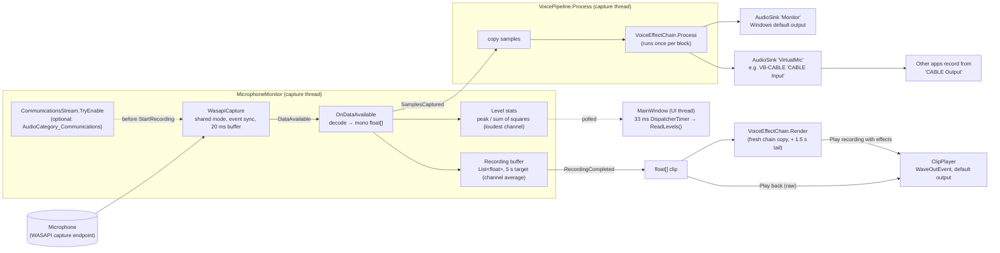

# Architecture

This document describes how Mic Check is put together: the audio path, each class and the thread it runs on, the effects engine, the Windows voice-processing hook, and the tray/app lifecycle. It is written for contributors. If you just want to use the app, start with the [README](../README.md) and the [user guide](user-guide.md).

Related docs: [development guide](development.md) · [voice effects](voice-effects.md) · [virtual microphone](virtual-microphone.md) · [troubleshooting](troubleshooting.md)

## Contents

- [Overview](#overview)
- [Components](#components)
- [Threading model](#threading-model)
- [Effects engine](#effects-engine)
- [Windows voice processing](#windows-voice-processing)
- [App and tray lifecycle](#app-and-tray-lifecycle)
- [Settings and presets persistence](#settings-and-presets-persistence)
- [Format handling](#format-handling)
- [Known limitations and design trade-offs](#known-limitations-and-design-trade-offs)

## Overview

Mic Check is a single-project WPF app (`src/MicCheck`, `net10.0-windows`, NAudio 2.2.1). It captures one microphone over WASAPI, shows live levels, records a 5-second clip, and can send the mic through a chain of voice effects to two outputs: your own headphones ("Hear myself live") and a virtual audio cable such as VB-CABLE, which other apps then use as a microphone.

Key points:

- There is exactly one capture stream and one effect chain. The chain runs once per captured block and the same processed buffer is written to both sinks.
- If neither sink is running, `VoicePipeline.Process` returns before touching the chain, so effects cost nothing when nobody is listening.
- Level metering and recording always see the dry (unprocessed) signal. Recorded clips are stored dry; effects are applied to a clip only at playback, offline, by `VoiceEffectChain.Render`.

## Components

Source layout under `src/MicCheck`:

| Folder | Contents |
| --- | --- |
| (root) | `App`, `MainWindow`, `AppSettings` + `StartupRegistration`, `TrayIcon` |
| `Audio/` | `MicrophoneMonitor`, `CommunicationsStream`, `VoicePipeline`, `AudioSink`, `ClipPlayer` |
| `Effects/` | `VoiceEffect` + `EffectParameter`, the seven effects, `VoiceEffectChain`, `EffectPreset` + `PresetStore` |
| `Controls/` | `LevelMeter`, `LevelHistory`, `VoiceEffectsPanel` |

### `App` (`App.xaml`, `App.xaml.cs`)

- Sets `ThemeMode="System"` (WPF Fluent theme following the Windows light/dark setting) and `ShutdownMode="OnExplicitShutdown"`, and defines the shared `Card`, `SectionTitle` and `Caption` styles.
- `OnStartup` enforces a single instance, creates `MainWindow`, and shows it unless `--tray` was passed. See [App and tray lifecycle](#app-and-tray-lifecycle).
- `OnExit` unregisters the thread-pool wait and disposes the named event and the mutex.

### `MainWindow` (`MainWindow.xaml`, `MainWindow.xaml.cs`)

The composition root and the only real controller. Everything is code-behind; there is no MVVM layer.

Owns (constructed as fields, disposed in its private `Shutdown()`):

| Field | Type | Purpose |
| --- | --- | --- |
| `_settings` | `AppSettings` | Loaded once in the field initializer, saved at the points listed under [persistence](#settings-and-presets-persistence). |
| `_enumerator` | `MMDeviceEnumerator` | Device enumeration for both mic and output lists. |
| `_monitor` | `MicrophoneMonitor` | The capture stream. |
| `_pipeline` | `VoicePipeline` | Effect chain and both sinks. |
| `_player` | `ClipPlayer` | Clip playback. |
| `_tray` | `TrayIcon` | Notification-area icon. |
| `_devices` | `List<DeviceItem>` | One `MMDevice` per active capture endpoint. These are kept alive (the selected one is passed to `WasapiCapture` and used for `AudioEndpointVolume`) and disposed on every reload and at shutdown. |
| `_timer` | `DispatcherTimer` (Render priority, 33 ms) | Meter refresh (`OnTick`). |
| `_reconnectTimer` | `DispatcherTimer` (5 s) | Device recovery (`OnReconnectTick`). |

Responsibilities, by region of the file:

- **Devices**: `LoadDevices` enumerates active capture endpoints, labels the Windows default (`Role.Console`) and sorts it first, then selects the saved `MicrophoneId` or the first entry. `StartSelectedDevice` starts `MicrophoneMonitor`, writes the format line (`Monitoring · 48,000 Hz · 2 ch · 32-bit float · noise filtering on`), tells the effects panel the sample rate, and (re)starts the virtual mic. `StopMonitoring` tears all of that down.
- **Windows input volume**: subscribes to the selected device's `AudioEndpointVolume.OnVolumeNotification` (raised on a COM thread, marshalled with `Dispatcher.InvokeAsync`) and writes `MasterVolumeLevelScalar` / `Mute` from the slider and checkbox. `_syncingVolume` stops the notification → slider → setter loop.
- **Metering**: `OnTick` polls `ReadLevels()`, converts to dBFS (floor `LevelMeter.MinDb` = -60), applies ballistics (instant rise, 24 dB/s fall), a 1.5 s peak hold and a 2 s clip indicator (peak ≥ 0.99), and picks a status from the held peak: Clipping, No signal (< -55), Very quiet (< -30), A bit quiet (< -18), Good level (< -3), otherwise Loud. It does nothing while the window is hidden.
- **Record and play back**: `OnRecordClick` calls `BeginRecording(5 s)`; `OnRecordingCompleted` (raised on the capture thread) marshals the clip to the UI thread. `TogglePlayback` plays the dry clip or `Chain.Render(clip)`; pressing the button for what is already playing stops it.
- **Virtual microphone**: `LoadOutputs` lists active render endpoints, sorted with any name containing `CABLE Input` first. It never selects a real speaker by default: only the saved `VirtualMicDeviceId` or a cable. `ApplyVirtualMic` stops and restarts `VirtualMic` at the capture sample rate. `UpdateVirtualMicStatus` writes the status line and the tray tooltip/check state.
- **Tray**: close-to-tray, `ShowFromTray`, `ExitApp`.

### `MicrophoneMonitor` (`Audio/MicrophoneMonitor.cs`)

- `Start(MMDevice, bool voiceProcessing)` creates `WasapiCapture(device, useEventSync: true, audioBufferMillisecondsLength: 20)` (shared mode), optionally calls `CommunicationsStream.TryEnable`, normalises `WaveFormatExtensible` to a standard format, rejects unsupported formats with `NotSupportedException`, subscribes to `DataAvailable` / `RecordingStopped`, and calls `StartRecording()`.
- `OnDataAvailable` (capture thread) decodes each frame. Levels use the *loudest* channel, so a mic that only feeds one channel of a stereo stream still reads correctly; the mono signal sent onwards is the *average* of the channels. It accumulates peak and sum of squares under `_gate`, appends to the recording if one is in progress, then raises `SamplesCaptured` (every block) and `RecordingCompleted` (once, with the finished clip). Both events are raised outside the lock.
- `ReadLevels()` returns peak and RMS since the previous call and resets the accumulators. Because it is reset-on-read, the meter shows exactly what happened between two ticks, regardless of how many capture blocks arrived.
- `BeginRecording(duration)` allocates a `List<float>` sized `SampleRate × seconds`. `IsRecording` and `RecordingProgress` read under the lock.
- `Stop()` unsubscribes, disposes the capture (which joins the capture thread), and resets stats and any unfinished recording.
- `Faulted` is raised on the UI thread when the stream stops on its own (for example the device is unplugged). `OnRecordingStopped` ignores stale senders, calls `Stop()`, then raises `Faulted`.
- `VoiceProcessingEnabled` reports whether the communications category was actually applied.

### `CommunicationsStream` (`Audio/CommunicationsStream.cs`)

Static helper that tags a `WasapiCapture` as a voice-communications stream. Detailed under [Windows voice processing](#windows-voice-processing).

### `VoicePipeline` (`Audio/VoicePipeline.cs`)

Owns one `VoiceEffectChain` (`Chain`) and two `AudioSink`s (`Monitor`, `VirtualMic`). `Process(samples, sampleRate)` runs on the capture thread: it returns early if the rate is 0 or neither sink is running, otherwise it copies the block (`SamplesCaptured` handlers must not modify the shared array), runs the chain in place on the copy, and writes the result to both sinks. `Dispose()` disposes both sinks.

`MainWindow` wires it up with `_monitor.SamplesCaptured += (_, s) => _pipeline.Process(s, _monitor.SampleRate)`. `VoiceEffectsPanel` owns the decision to start and stop `Monitor`; `MainWindow` owns `VirtualMic`.

### `AudioSink` (`Audio/AudioSink.cs`)

Plays a stream of mono float samples to one render endpoint.

- `Start(inputSampleRate, deviceId)` opens the device (`null` means the default render endpoint for `Role.Multimedia`, resolved once at start), builds the provider chain described under [Format handling](#format-handling), creates `WasapiOut(device, Shared, useEventSync: true, latency: 40)`, and starts playback. On any failure it disposes what it created and rethrows; callers show the message.
- `Write(float[])` (capture thread) appends to a `BufferedWaveProvider`. If more than 150 ms is already buffered (`MaxBacklog`) it clears the buffer first, so a stall produces a short dropout instead of permanently increased latency.
- `Stop()` clears `_buffer` first, then disposes the `WasapiOut` and the `MMDevice`.
- `Faulted` is raised on the UI thread when playback stops unexpectedly. The handler ignores events from an output that has already been replaced (`_output != output`).
- Owns its `MMDevice` and `WasapiOut`.

### `ClipPlayer` (`Audio/ClipPlayer.cs`)

Plays a mono float clip through the default output with `WaveOutEvent` (WinMM, not WASAPI), converting to 16-bit PCM with `ToWaveProvider16()`. `Finished` is raised on the UI thread when playback ends; like `AudioSink`, the handler ignores stale outputs so `Stop()` followed by a new `Play()` doesn't fire a spurious `Finished`. Used for both the dry clip and the effected render.

### `VoiceEffect`, `EffectParameter`, the effects, `VoiceEffectChain` (`Effects/`)

See [Effects engine](#effects-engine).

### `EffectPreset`, `EffectPresetEntry`, `PresetStore` (`Effects/EffectPreset.cs`)

- `EffectPreset(string Name, Dictionary<string, EffectPresetEntry> Effects)` and `EffectPresetEntry(bool Enabled, Dictionary<string, double> Values)` are records keyed by effect key and parameter key. They are the serialization format for both saved presets and the current settings.
- `EffectPreset.BuiltIn` holds the nine built-in presets (No effects, Chipmunk, Deep voice, Robot, Telephone, Megaphone, Cave, Stadium announcer, Alien).
- `EffectPreset.Sanitize` hardens hand-edited JSON (see [persistence](#settings-and-presets-persistence)).
- `PresetStore.Load/Save` reads and writes the user's presets file.

### `VoiceEffectsPanel` (`Controls/VoiceEffectsPanel.xaml[.cs]`)

The right-hand column. `Initialize(pipeline, presetName)` must be called once by `MainWindow`.

- The effect cards are generated from `Chain.Effects` with `DataTemplate`s: a checkbox bound to `Enabled`, and one slider per `EffectParameter` bound to `Value`, with `Minimum`/`Maximum`/`TickFrequency` from the parameter (`IsSnapToTickEnabled`, so sliders move in `Step` increments) and a label bound to `DisplayValue`. Adding an effect needs no XAML.
- Presets: the combo lists built-ins followed by user presets (alphabetical, shown with "(saved)"). Selecting one calls `Chain.Apply`. Any edit to an effect or parameter afterwards deselects the preset, so picking it again re-applies it. Saving rejects empty names and built-in names (case-insensitive) and replaces a user preset of the same name.
- Live monitoring: `SetInput(sampleRate)` is called by `MainWindow` whenever capture starts (rate) or stops (0). It restarts the `Monitor` sink on the default output if "Hear myself live" is on. If the sink faults, the toggle is unchecked and the error shown; it is not retried automatically.
- "Play recording with effects" just raises `PlayRecordingClicked`; `MainWindow` does the playback.

### `LevelMeter`, `LevelHistory` (`Controls/`)

Custom `FrameworkElement`s that draw in `OnRender`. `LevelMeter` draws a -60..0 dBFS bar (solid RMS, 35 % opacity peak, a 2 px peak-hold tick, scale marks at -60, -48, -36, -24, -18, -12, -6, -3, 0) with a fixed green/yellow/orange/red gradient. `LevelHistory` is a 300-point ring buffer (≈10 s at the 33 ms tick) drawn as a filled area graph with grid lines at -12, -24, -36, -48 dB. Their brushes are dependency properties set from `DynamicResource` theme brushes in `MainWindow.xaml`.

### `TrayIcon` (`TrayIcon.cs`)

A WinForms `NotifyIcon` (the only reason the project sets `UseWindowsForms`). The icon is drawn at runtime with GDI+ (no icon resource file); the `HICON` from `Bitmap.GetHicon()` is freed with `DestroyIcon` on dispose. Menu: **Open Mic Check** (bold), **Send voice to virtual mic** (check item), **Exit**. Left-click also opens. It only raises events (`OpenRequested`, `ExitRequested`, `VirtualMicToggled`); `MainWindow` decides what they do. `SetVirtualMicState` updates the check mark and the tooltip (truncated to the 127-character `NotifyIcon` limit). `ShowStillRunningHint` shows a balloon once per session.

### `AppSettings`, `StartupRegistration` (`AppSettings.cs`)

See [persistence](#settings-and-presets-persistence) and [Start with Windows](#start-with-windows).

## Threading model

Three kinds of thread touch the audio objects:

| Thread | Runs |
| --- | --- |
| UI (WPF dispatcher) | All of `MainWindow`, `VoiceEffectsPanel`, `TrayIcon`; `Start`/`Stop` on `MicrophoneMonitor`, `AudioSink`, `ClipPlayer`; writes to `VoiceEffect.Enabled` and `EffectParameter.Value`; `ReadLevels`; `VoiceEffectChain.Render`; all `Faulted` / `Finished` events. |
| NAudio capture thread (one per `WasapiCapture`) | `MicrophoneMonitor.OnDataAvailable` → `SamplesCaptured` → `VoicePipeline.Process` → `VoiceEffectChain.Process` → `AudioSink.Write`; `RecordingCompleted`. |
| NAudio render threads (one per `WasapiOut`, one for `WaveOutEvent`) | Pull from `BufferedWaveProvider` → resampler → multiplexer. No app code runs here. |

Plus incidental threads: the COM thread that raises `OnVolumeNotification` (marshalled with `Dispatcher.InvokeAsync`) and the thread-pool thread that waits on the single-instance show event (also marshalled with `Dispatcher.InvokeAsync`).

The specific reasoning that keeps this safe:

**Level stats and recording: a lock.** `MicrophoneMonitor._gate` guards `_peak`, `_sumSquares`, `_sampleCount`, `_recording` and `_recordingTarget`. The capture thread computes the block's stats without the lock and only merges them inside it, so the critical section is tiny. Events are raised after the lock is released.

**Effect enable/reset: volatile flags, reset on the audio thread.** `VoiceEffect._enabled` and `_resetPending` are `volatile`. The `Enabled` setter (UI thread) writes `_resetPending = true` *before* `_enabled = true`, so when the audio thread observes the effect as enabled it also observes the pending reset. `Process` (audio thread) then calls `Reset(sampleRate)`, which is where effects allocate delay lines and filters. Because state is (re)built only on the thread that uses it, the UI never reallocates a buffer that `ProcessCore` is indexing. A sample-rate change (new mic) also triggers a reset, detected by comparing with the last `_sampleRate`.

**Parameters: plain doubles, tolerated races.** `EffectParameter.Value` is a non-volatile `double` written by the UI (via data binding) and read once per block by `ProcessCore`. On x64, aligned 8-byte reads and writes are atomic, so the worst case is that a block uses the previous value. Effects derive everything else from the parameter at the start of each block (or, for `BandPassEffect`, recompute coefficients on the audio thread when the value differs from the last applied one), so no derived state is shared across threads. `VoiceEffectChain.Apply` (switching preset) is not atomic: one block may run with a mix of old and new values, which is inaudible in practice.

**Sinks: local-copy pattern.** `AudioSink.Write` reads `_buffer` into a local once and uses only the local. `Stop()` (UI thread) sets `_buffer = null` *before* disposing the output. A `Write` racing with `Stop` therefore either sees `null` and returns, or holds a reference to the old `BufferedWaveProvider` and harmlessly adds samples to a buffer nobody will read. It can never dereference a field that becomes null mid-method. `BufferedWaveProvider` itself is internally synchronised between the writer and NAudio's render thread. `VoicePipeline.Process` checks `IsRunning` the same way (a single read of `_output`).

**Capture shutdown: Dispose joins the thread.** In NAudio 2.2.1, `WasapiCapture.Dispose()` stops recording and joins the capture thread. So when `MicrophoneMonitor.Stop()` returns on the UI thread, no `DataAvailable` callback is still running, and callers can safely stop the sinks, reset the UI or start a new capture right after. This is also why the capture thread must never block on the UI thread: `OnRecordingCompleted` uses `Dispatcher.InvokeAsync`, never `Invoke`, otherwise `Stop()` would deadlock against it.

**NAudio events are raised via `SynchronizationContext`.** `WasapiCapture`, `WasapiOut` and `WaveOutEvent` capture `SynchronizationContext.Current` when constructed and post `RecordingStopped` / `PlaybackStopped` to it. All three are constructed on the UI thread, so `Faulted` and `Finished` arrive on the UI thread and their handlers touch controls directly. Each handler checks that the sender is still the current object (`sender != _capture`, `_output != output`), because a stop event for a stream that was deliberately replaced can arrive after its replacement has started. `MicrophoneMonitor.Stop()` additionally unsubscribes before disposing, so a deliberate stop never raises `Faulted`.

**Render runs on a private chain.** `VoiceEffectChain.Render` (UI thread) builds a fresh `VoiceEffectChain`, copies the current settings into it with `Apply(ToPreset(""))`, and processes the clip there. The live chain's delay lines and filter state are never touched by the UI thread; the test `RenderLeavesInputAndLiveChainUntouched` checks this.

## Effects engine

### Base classes

`EffectParameter(key, label, minimum, maximum, defaultValue, step, format)` is a bindable (`INotifyPropertyChanged`) setting. `Value` is clamped to `[Minimum, Maximum]`; setting an equal value raises nothing; otherwise it raises `PropertyChanged` for `Value` and `DisplayValue`. `DisplayValue` formats with `string.Format(CurrentCulture, format, value)`.

`VoiceEffect(key, name, description)` is the abstract base:

- `Key` is the stable identifier used in presets and settings JSON. `Name` and `Description` are shown in the UI.
- `AddParameter(...)` (protected, called from the constructor) registers a parameter and returns it for the subclass to keep in a field.
- `Process(span, sampleRate)` does nothing when disabled, calls `Reset(sampleRate)` if a reset is pending or the rate changed, then `ProcessCore`.
- `Reset(int)` (virtual, default no-op) rebuilds state. `ProcessCore` (abstract) processes a block of mono samples in place.
- Helpers: `DbToGain(db)` = 10^(db/20); `FlushDenormal(x)` returns 0 when |x| < 1e-15.
- `RestoreDefaults()` resets every parameter to its `Default`.

### Processing order

`VoiceEffectChain` holds one instance of each effect in a fixed array; the order is the processing order and the order shown in the UI:

| # | Class | Key | UI name | Parameters (key: range, default, step) |
| --- | --- | --- | --- | --- |
| 1 | `GainEffect` | `gain` | Volume | `gain`: -12..24 dB, 6, 0.5 |
| 2 | `PitchShiftEffect` | `pitch` | Pitch shift | `semitones`: -12..12, 5, 0.5 |
| 3 | `DistortionEffect` | `distortion` | Distortion | `drive`: 0..40 dB, 20, 1 · `mix`: 0..1, 1, 0.05 |
| 4 | `BandPassEffect` | `bandpass` | Telephone filter | `lowCut`: 20..2000 Hz, 400, 10 · `highCut`: 1000..12000 Hz, 3000, 100 |
| 5 | `RingModulatorEffect` | `ring` | Robot (ring modulator) | `frequency`: 20..1000 Hz, 60, 5 · `mix`: 0..1, 1, 0.05 |
| 6 | `EchoEffect` | `echo` | Echo | `delay`: 20..1000 ms, 300, 10 · `feedback` (Repeats): 0..0.9, 0.4, 0.05 · `mix`: 0..1, 0.4, 0.05 |
| 7 | `ReverbEffect` | `reverb` | Reverb | `roomSize`: 0..1, 0.7, 0.05 · `damping`: 0..1, 0.5, 0.05 · `mix`: 0..1, 0.3, 0.05 |

The order in a preset's dictionary is irrelevant; for example the Telephone preset lists `gain` last but gain is still applied first. After all effects, `Process` hard-clamps every sample to [-1, 1] ("so a runaway setting can't blast your ears"). The clamp is unconditional: with every effect off, samples already in range pass through bit-identical (`NoEffectsIsIdentity` test).

`ToPreset(name)` snapshots every effect (enabled flag and all parameter values). `Apply(preset)` first restores defaults on every effect, then for each effect present in the preset sets the known parameter values and the enabled flag; effects missing from the preset are switched off; unknown effect or parameter keys are ignored.

`Render(input, sampleRate)` processes a whole clip on a separate chain (see [threading](#threading-model)). If `EchoEffect` or `ReverbEffect` is enabled it appends 1.5 s of silence to the input so the tail is heard; otherwise output length equals input length. The whole clip is processed as a single block.

### DSP of each effect

**Gain.** Multiplies by `DbToGain(gain)`.

**Pitch shift: delay-line pitch shifter with sin² crossfade.** A ring buffer of `window + 4` samples, where `window` = 50 ms of samples. A phase φ in [0, 1) advances each sample by `(1 − ratio) / window`, with `ratio = 2^(semitones/12)`. Two read taps sit at delays φ·window and ((φ + 0.5) mod 1)·window behind the write head, read with linear interpolation. Because the read delay changes by `(1 − ratio)` samples per sample, each tap reads at `ratio` times real time, which shifts pitch; when a tap's delay wraps from one end of the window to the other there would be a discontinuity, so each tap is weighted by sin²(π·φ), which is zero at the wrap. The two taps are half a period apart, so their weights are sin² and cos² of the same angle and always sum to 1 (no amplitude modulation). Upward shifts have negative step (delay shrinks), downward shifts positive. The effect adds 0–50 ms (≈25 ms average) of delay and, like any time-domain shifter, some "warble" on sustained tones; formants shift with pitch. Tests assert a 220 Hz sine ends up within ±10 % of the expected frequency for -12, -5, +5 and +12 semitones.

**Distortion: tanh soft clipping with compensation.** `pre = DbToGain(drive)`, `post = 1/√pre`, `y = tanh(x·pre)·post`, then a linear dry/wet blend `x + mix·(y − x)`. The `1/√pre` term removes half the drive in dB, so turning up drive adds saturation without the full level increase (the final clamp catches what's left). At drive 0 dB the curve is plain `tanh(x)`, a very mild saturation, not an identity.

**Telephone filter: cascaded biquad band-pass.** Two NAudio `BiQuadFilter` high-pass sections at `lowCut` and two low-pass sections at `highCut`, all with Q = 0.707. Cascading two Butterworth sections gives 24 dB/octave slopes (Linkwitz-Riley-style, -6 dB at each cutoff). The low-pass cutoff is capped at `0.45 × sampleRate` (`HighCutFor`), because headsets often capture at 16 kHz where a 12 kHz cutoff would be above Nyquist and make the filter unstable (test `BandPassAtLowSampleRateWithHighCutAboveNyquistStaysStable`). Filters are created in `Reset`; when a cutoff parameter changes, coefficients are recomputed in place on the audio thread at the start of the next block, keeping filter state so there is no click. The parameter ranges overlap (low cut up to 2000 Hz, high cut down to 1000 Hz), so it is possible to set low cut above high cut, which leaves almost nothing.

**Robot: ring modulator.** Multiplies by a sine oscillator: `x + mix·(x·sin φ − x)`, φ advancing by 2π·frequency/sampleRate and wrapped at 2π. Phase resets to 0 on `Reset`.

**Echo: feedback delay.** A 1-second (+1 sample) ring buffer allocated in `Reset`. Delay in samples = `delay_ms × rate / 1000`, clamped to [1, length − 1]. Per sample: read `delayed`, write `x + feedback·delayed` (denormal-flushed) back, output `x + mix·delayed`. The dry signal is not attenuated, so mix adds echo on top. Feedback is capped at 0.9 by the parameter range, so repeats always decay.

**Reverb: Freeverb-style, mono.** Eight parallel lowpass-feedback comb filters (tunings 1116, 1188, 1277, 1356, 1422, 1491, 1557, 1617 samples) summed, then four series all-pass filters (556, 441, 341, 225 samples, feedback 0.5). The tunings are Freeverb's values in samples at 44.1 kHz and are scaled by `sampleRate / 44100` in `Reset`, so the room sounds the same at 16 kHz and 48 kHz. Constants follow Freeverb: input gain 0.015, comb feedback `roomSize × 0.28 + 0.7` (0.70..0.98), damping `damping × 0.4`, wet scale 3. Output is `x·(1 − mix/2) + wet·3·mix`, so the dry level drops to 50 % at full mix. Only the left-channel tunings are used (no stereo spread), since the signal is mono.

### Denormal flushing

Feedback paths decaying on digital silence produce denormal floats, which are very slow on x64 and can spike CPU on the capture thread. `FlushDenormal` (|x| < 1e-15 → 0) is applied wherever a value is written back into a recirculating buffer: the echo buffer write, the reverb comb filters' damping state, and the all-pass buffer writes. NAudio's `BiQuadFilter` keeps its own state and is not flushed (see [limitations](#known-limitations-and-design-trade-offs)).

## Windows voice processing

The "Filter background noise (Windows voice processing)" checkbox makes `MicrophoneMonitor.Start` call `CommunicationsStream.TryEnable(capture)` before `StartRecording()`.

**What it does.** It calls `IAudioClient2::SetClientProperties` with an `AudioClientProperties` struct whose `eCategory` is `AudioCategory_Communications` (value 3). This tells the Windows audio engine the stream is a voice call, so it inserts the endpoint's communications-mode processing: on Windows 11 with supported hardware that is Voice Clarity (AI noise suppression, which also removes keyboard and mouse clicks); on other systems it is whatever the driver's audio processing objects (APOs) provide, typically noise suppression and echo cancellation. Mic Check does no noise reduction of its own. `SetClientProperties` must be called before `IAudioClient::Initialize`, which NAudio performs inside `StartRecording()`; that is why `TryEnable` runs between construction and start.

**Why reflection.** NAudio 2.2.1 exposes no way to reach `IAudioClient2` for a `WasapiCapture`. `WasapiCapture` keeps its `AudioClient` in a private field named `audioClient`, and `AudioClient` keeps the raw COM interface in a private field named `audioClientInterface`. `CommunicationsStream` reads both with `FieldInfo` (looked up once, in static fields) and casts the COM object to its own `IAudioClient2` declaration; the runtime's COM interop performs the `QueryInterface`. These field names are implementation details of NAudio 2.2.1, which is why the package version is pinned.

**The `_VtblGap` declaration.** `IAudioClient2` derives from `IAudioClient`, but a `[ComImport]` interface in .NET cannot inherit the vtable layout of another declared interface. The declaration is therefore flat (`InterfaceIsIUnknown`, GUID `726778CD-F60A-4eda-82DE-E47610CD78AA`) and starts with `void _VtblGap1_12();`. The CLR treats a method named `_VtblGap<seq>_<count>` as a placeholder for `<count>` vtable slots, so this skips the 12 inherited `IAudioClient` methods and puts `IsOffloadCapable` and `SetClientProperties` at the correct slot offsets. The struct is declared sequential with four `int` fields (`Size`, `IsOffload`, `Category`, `Options`), the layout of `AudioClientProperties` on Windows 8.1+; `Size` is set from `Marshal.SizeOf`.

**Failure fallback.** Every failure mode returns `false` and leaves the stream running unprocessed: a field not found (a different NAudio build), the COM object not implementing `IAudioClient2`, or `SetClientProperties` throwing a `COMException`. `VoiceProcessingEnabled` records the result and the format line in the UI shows "noise filtering on", "noise filtering unavailable for this device", or "raw signal". Note that a `true` result only means Windows accepted the category; whether any audible processing happens depends on the device and its drivers. Toggling the checkbox restarts capture, because the category can only be set before initialization.

## App and tray lifecycle

### Single instance

`App.OnStartup` creates a named `Mutex` (`MicCheck.SingleInstance`, initially owned) and a named auto-reset `EventWaitHandle` (`MicCheck.ShowWindow`). Neither name has a `Global\` prefix, so they are per-session.

- **Second instance**: if the mutex already existed, the process sets the event and calls `Shutdown()` before creating any window, tray icon or audio object. This happens with or without `--tray`.
- **First instance**: creates `MainWindow` and registers a thread-pool wait on the event (`ThreadPool.RegisterWaitForSingleObject`, repeating). When it fires, it marshals to the dispatcher and calls `window.ShowFromTray()` (Show, un-minimize, Activate), unless the window has already closed (`MainWindow.IsClosed`), because a second launch can arrive during shutdown and `Show()` on a closed window throws.

Only one instance can own the mic and the virtual cable, so a second launch simply brings the first to the front.

### `--tray` and `ShutdownMode`

`ShutdownMode="OnExplicitShutdown"` means WPF never exits just because no window is visible. `MainWindow` is always constructed (devices load, capture starts, the virtual mic starts, the tray icon appears), but with `--tray` (`StartupRegistration.TrayArgument`) it is not shown. The meter timer keeps ticking but `OnTick` returns immediately while the window is hidden.

### Closing the window

`OnClosing` saves settings, then:

- If the virtual mic checkbox is on and the close didn't come from the tray's **Exit**, it cancels the close, hides the window and shows the "Mic Check is still running" balloon (once per session). Other apps keep receiving the processed voice.
- Otherwise the window really closes. `Closed` sets `IsClosed`, then the private `MainWindow.Shutdown()` stops both timers, detaches the volume callback, disposes the monitor, pipeline, player, tray icon, device list and enumerator, and calls `Application.Current.Shutdown()`.

So with the virtual mic off, closing the window exits the app entirely. Minimizing is ordinary minimizing (to the taskbar), not to the tray.

The tray's **Send voice to virtual mic** item sets the window's checkbox, applies it and saves settings, exactly like clicking the checkbox.

### Reconnect timer

`OnReconnectTick` runs every 5 seconds, visible or hidden:

1. **Mic not running** (never opened, or `Faulted`): it builds a sorted, `|`-joined string of active capture endpoint IDs.
   - If the window is visible and that set is unchanged since the last attempt, it does nothing. Reloading resets the UI and stops clip playback, and a mic that is present but refuses to open (privacy settings, exclusive use by another app) would otherwise be retried in a loop under the user. While hidden, it retries every tick.
   - Otherwise it remembers the set and, if there is no saved mic or the saved `MicrophoneId` is among the active IDs, calls `LoadDevices(saved)`, which restarts capture and the virtual mic. If a saved mic is missing it waits for that mic rather than silently switching to another.
2. **Mic running, virtual mic wanted but not running, and an output is selected**: calls `ApplyVirtualMic()`, retrying the cable every 5 s (for example after the cable's endpoint was disabled and re-enabled).

The "Hear myself live" sink is not retried; if it faults the toggle is unchecked.

### Start with Windows

`StartupRegistration` manages `HKCU\Software\Microsoft\Windows\CurrentVersion\Run`, value `MicCheck`, data `"<Environment.ProcessPath>" --tray`. `IsEnabled` only checks that the value exists, not that it points at the current exe. The checkbox reflects the registry at startup and writes it on click; on `UnauthorizedAccessException`, `SecurityException` or `IOException` it reverts the checkbox and shows the error. Because the stored path is absolute, moving or renaming the exe breaks the entry while the checkbox still shows ticked: untick and re-tick it after moving. Enabling it from a `dotnet run` session registers the exe in `bin`.

## Settings and presets persistence

Both files live in `%AppData%\MicCheck` (`Environment.SpecialFolder.ApplicationData`), are written with `System.Text.Json` (`WriteIndented`, default PascalCase property names), and are created on first save.

### `settings.json` (`AppSettings`)

| Property | Meaning |
| --- | --- |
| `MicrophoneId` | WASAPI endpoint ID of the mic the user last *chose*. Automatic fallbacks (saved mic missing, first device picked) are not saved. |
| `NoiseFilter` | Windows voice processing checkbox (default `true`). |
| `VirtualMicEnabled` | "Send my processed voice to" checkbox. |
| `VirtualMicDeviceId` | Render endpoint ID of the chosen virtual mic output, again only when chosen by the user. |
| `PresetName` | Name of the selected preset, or `null` if the settings have been edited since. |
| `Effects` | Full snapshot of the chain as an `EffectPreset` named `"Current"`. |

Not persisted: the "Hear myself live" toggle, the recorded clip, window size/position, and the Windows input volume (that belongs to Windows). "Start with Windows" lives in the registry, not here.

When it is saved: when the window is deactivated (loses focus), on every close attempt (including close-to-tray), on Windows session end, and right after changing the mic, the noise filter, the virtual mic checkbox (window or tray) or the virtual mic device. Effect slider and preset changes are therefore saved the next time the window loses focus or closes, not instantly. Save failures (`IOException`, `UnauthorizedAccessException`) are swallowed.

On load: an unreadable or malformed file (`IOException`, `JsonException`, `UnauthorizedAccessException`) gives defaults. `Effects` is passed through `EffectPreset.Sanitize`. On startup the saved `Effects` are applied to the chain, and the preset combo reselects `PresetName` without re-applying it. With no saved effects (first run) the combo selects "No effects".

### `voice-presets.json` (`PresetStore`)

A JSON array of `EffectPreset`. Loaded once when the effects panel is constructed; written immediately on **Save preset** and **Delete** (errors are shown in the panel status line). Each entry is sanitized on load and unusable entries are dropped. A malformed file loads as an empty list, and the next save overwrites it.

### Sanitizing hand-edited JSON

`System.Text.Json` happily deserializes `null` into non-nullable record members, which would crash `Apply`. `EffectPreset.Sanitize` returns `null` (preset discarded) if `Name` is null/blank or `Effects` is null, and otherwise drops any effect entry that is null or has null `Values`. Unknown effect and parameter keys survive sanitizing but are ignored by `Apply`; out-of-range numbers are clamped by `EffectParameter.Value`. If a hand-edited user preset has the same name as a built-in, the user's one is selected (the combo uses the last case-insensitive match).

## Format handling

### Capture

`WasapiCapture` uses the endpoint's shared-mode mix format. `WaveFormatExtensible` is converted with `ToStandardWaveFormat()`, then `MicrophoneMonitor.IsSupported` accepts:

- IEEE float, 32-bit
- PCM, 16-, 24- or 32-bit

at any sample rate and channel count. Anything else throws `NotSupportedException` ("Unsupported capture format: ..."), shown as "Couldn't open this microphone". In practice Windows shared-mode mix formats are almost always 32-bit float. Samples are decoded little-endian to float in [-1, 1) (16-bit ÷ 32768, 24-bit sign-extended ÷ 8388608, 32-bit int ÷ 2³¹), then reduced to mono as described in [`MicrophoneMonitor`](#microphonemonitor-audiomicrophonemonitorcs). Everything downstream (levels, recording, effects, sinks) is mono float at the capture sample rate. The effects are sample-rate aware (delay lengths, filter coefficients, reverb tunings are computed from the rate) and are tested at 16 kHz and 48 kHz.

### Output (`AudioSink`)

Provider chain, from writer to device:

1. `BufferedWaveProvider`: mono IEEE float at the capture rate, 1 s capacity, `DiscardOnBufferOverflow`, plus the 150 ms backlog clear in `Write`.
2. `ToSampleProvider()`.
3. `WdlResamplingSampleProvider` to the device mix-format rate, only if the rates differ (for example a 16 kHz headset mic feeding a 48 kHz cable).
4. `MultiplexingSampleProvider([source], mixChannels)`, only if the device has more than one channel. With one input and its default mapping, the mono signal is copied to every output channel.
5. `ToWaveProvider()` (IEEE float) into `WasapiOut` (shared mode, event-driven, 40 ms latency).

The mix format is read from a temporary `AudioClient` that is disposed immediately, because `MMDevice.AudioClient` creates a new client on every access.

### Clip playback (`ClipPlayer`)

The clip is wrapped as a mono float `RawSourceWaveStream` and converted to 16-bit PCM for `WaveOutEvent`; Windows' WinMM mapper handles rate and channel conversion.

## Known limitations and design trade-offs

- **Latency budget.** Live monitoring and the virtual mic add roughly 60–100 ms end to end: the 20 ms capture buffer, the 40 ms `WasapiOut` latency, whatever is queued in the `BufferedWaveProvider` (up to the 150 ms backlog cap), resampler delay, plus the pitch shifter's 0–50 ms delay line when it is on. Apps on the other side of the virtual cable add their own buffering. That is fine for calls and streaming but noticeable when hearing yourself live, which is why the UI says "Expect a slight delay".
- **NAudio private-field dependency.** `CommunicationsStream` depends on NAudio 2.2.1's private `WasapiCapture.audioClient` and `AudioClient.audioClientInterface` fields. Upgrading NAudio can silently turn noise filtering into "unavailable for this device" (it fails safe, it doesn't crash). The package reference is pinned to exactly 2.2.1; re-check these field names before changing it.
- **BiQuad denormals.** NAudio's `BiQuadFilter` state is not flushed, so the telephone filter can produce denormals when decaying into pure digital silence. Real mics rarely deliver long runs of exact zeros and the filter's internal feedback decays quickly, so the exposure is small, but it is not covered by `FlushDenormal`. Wrapping `BiQuadFilter.Transform` output/state with a flush (or replacing it with an in-house biquad) would close the gap.
- **One chain for both outputs.** The monitor and the virtual mic share a single `VoiceEffectChain` and receive the identical processed buffer. You cannot hear yourself dry while sending effects, or vice versa. This keeps CPU and complexity down and guarantees you hear what others hear.
- **Effect state only advances while a sink is running.** When neither output is running the chain isn't processed at all, so echo/reverb buffers hold whatever they had when output stopped; it can be heard briefly when output resumes, unless the effect was toggled or the sample rate changed (both reset state).
- **Fixed effect order, one instance per effect.** The chain is a hard-coded array; users can't reorder effects or use two of the same.
- **Mono only.** Capture is mixed down to mono and the reverb has no stereo spread; output channels are duplicates.
- **Default output is resolved at start.** The "Hear myself live" sink and `ClipPlayer` bind to the default output when started; changing the Windows default output mid-session doesn't move them until they are restarted. The monitor sink is not auto-retried after a fault.
- **Shared mode only, mix-format capture.** No exclusive mode and no format negotiation; unusual mix formats (e.g. 8-bit) are rejected.
- **Recording length is fixed** at 5 seconds and recordings are not saved to disk.
- **Saving is focus-driven.** Effect edits reach `settings.json` on deactivate/close/session-end; killing the process while the window has focus loses unsaved effect edits.
- **Voice processing is best effort.** `VoiceProcessingEnabled` means Windows accepted the communications category, not that the device actually applies noise suppression.
