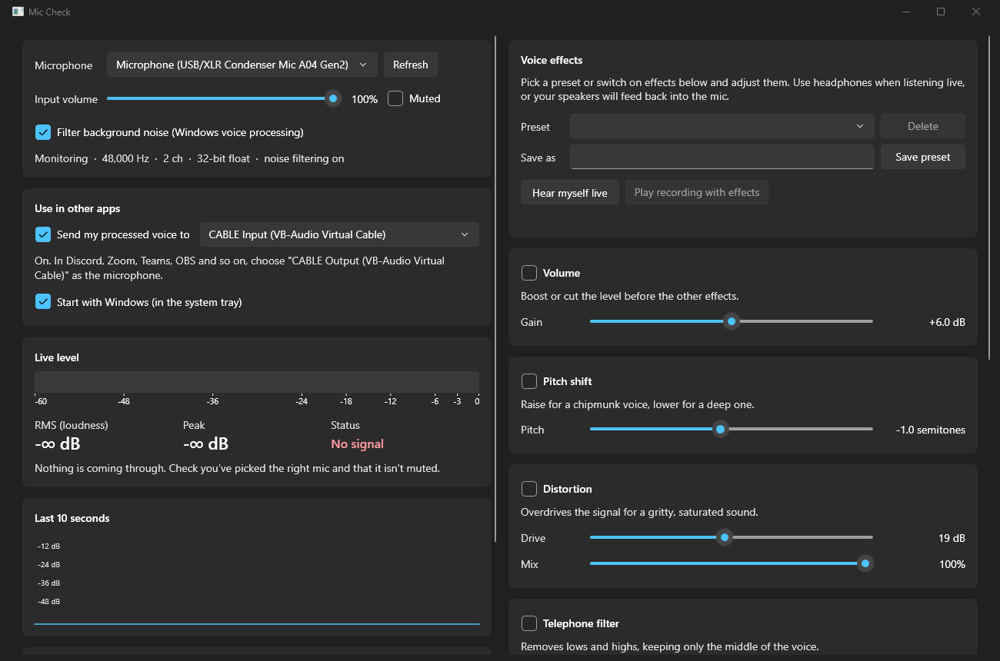

# User guide

This guide walks through every part of the Mic Check window. The left column is for testing your microphone; the right column is the voice effects panel.

- [Microphone](#microphone)
- [Use in other apps](#use-in-other-apps)
- [Live level](#live-level)
- [Last 10 seconds](#last-10-seconds)
- [Record and play back](#record-and-play-back)
- [Voice effects](#voice-effects)
- [System tray](#system-tray)
- [What gets remembered](#what-gets-remembered)

---

## Microphone



| Control | What it does |
| --- | --- |
| **Microphone** | Lists every active recording device. The Windows default device is listed first and marked "(Windows default)". Choosing a device starts monitoring it straight away. |
| **Refresh** | Re-scans for microphones and output devices. Use it after plugging something in or installing VB-CABLE. |
| **Input volume** | The Windows recording level for the selected mic, the same setting as in Windows Sound settings. Moving it changes the level for every app. If you change it elsewhere (Windows settings, a hardware dial), the slider follows. |
| **Muted** | The Windows mute switch for the mic. A muted mic shows "No signal". |
| **Filter background noise (Windows voice processing)** | Asks Windows to treat Mic Check's stream as a voice call, which turns on Windows' noise suppression: Voice Clarity on Windows 11, or the mic driver's own processing. This removes keyboard typing, mouse clicks, fans and other background noise. It's on by default. Turn it off to test the raw microphone. Toggling it restarts the mic. |

The line under the controls shows the capture format and processing state, for example:

```
Monitoring · 48,000 Hz · 2 ch · 32-bit float · noise filtering on
```

| Processing state | Meaning |
| --- | --- |
| `noise filtering on` | Windows accepted the request for voice processing. |
| `noise filtering unavailable for this device` | Windows or the device refused it; you're hearing the raw mic. |
| `raw signal` | The filter checkbox is off. |

> **Note:** With the filter on, Windows' noise suppression can output complete digital silence between words. The meter then reads **-∞ dB / No signal** while you're quiet, which is normal. Speak, and it should move.

> **Side effect:** Because Windows treats the stream as a voice call, it may turn down other sounds (music, videos) while Mic Check is running. To stop this, open **Control Panel → Sound → Communications** and choose **Do nothing**.

## Use in other apps

This section sends your processed voice (noise filter plus voice effects) to a virtual audio cable, so other apps can use it as a microphone. See [virtual-microphone.md](virtual-microphone.md) for the full setup.

| Control | What it does |
| --- | --- |
| **Send my processed voice to** | Turns sending on or off. |
| Device list | The output device to send to. This is normally **CABLE Input (VB-Audio Virtual Cable)**, which is picked automatically once VB-CABLE is installed. Any output device can be chosen, but Mic Check never picks your real speakers by itself. |
| Status line | Tells you what to do next: which microphone to choose in other apps, whether VB-CABLE is missing, or why sending stopped. |
| **Start with Windows (in the system tray)** | Starts Mic Check hidden in the tray when you sign in, so your processed mic is always available. |

While sending is on, closing the window keeps Mic Check running in the [system tray](#system-tray).

## Live level

The meter shows your input level in **dBFS** (decibels relative to full scale): 0 dB is the loudest the mic can record, and -60 dB is near silence.

| Part of the meter | Meaning |
| --- | --- |
| Solid bar | **RMS**, the average loudness: the "body" of your voice. |
| Faded bar | **Peak**, the loudest instant. |
| White marker | **Peak hold**, the highest recent peak. It holds for 1.5 seconds, then falls. |
| Colors | Green up to about -18 dB, then yellow, orange and red near 0 dB. |
| **CLIPPING** badge | Appears for 2 seconds whenever the signal hits full scale. Clipping sounds harsh and distorted. |

The bars rise instantly and fall back at 24 dB per second, like a hardware meter.

**Status** gives a plain-English verdict based on the peak-hold level, so it doesn't flicker between syllables:

| Status | Peak hold | Advice |
| --- | --- | --- |
| No signal | below -55 dB | Check the right mic is selected and not muted. |
| Very quiet | -55 to -30 dB | Speak up, move closer or raise the input volume. |
| A bit quiet | -30 to -18 dB | Usable; raise the input volume a little. |
| **Good level** | -18 to -3 dB | The sweet spot for speech. |
| Loud | above -3 dB | Close to clipping; lower the input volume a little. |
| Clipping | hit 0 dB | Lower the input volume or move back. |

## Last 10 seconds

A scrolling graph of your RMS level over the last 10 seconds, newest on the right, with grid lines at -12, -24, -36 and -48 dB. It's useful for:

- Seeing your noise floor (the line while you're silent).
- Checking that typing or clicks stay low with the noise filter on, compared with off.
- Seeing whether your level is consistent across a sentence.

## Record and play back

1. Press **Record 5 s** and speak. The progress bar fills over 5 seconds.
2. Press **Play back** to hear the clip through your default output device. Press it again (**Stop**) to stop.

The recording is mono, taken after the noise filter but before voice effects. To hear it with effects, use **Play recording with effects** in the effects panel. Use headphones, or the mic will pick up the playback.

Changing microphone during a recording cancels it; your previous clip, if any, stays playable.

## Voice effects

The right-hand panel. For what each effect does and its settings, see [voice-effects.md](voice-effects.md).

| Control | What it does |
| --- | --- |
| **Preset** | Choose a built-in or saved preset. Selecting one applies it immediately. As soon as you change any setting, the preset box clears, so selecting the same preset again restores it. Saved presets are marked "(saved)". |
| **Delete** | Deletes the selected saved preset. Built-in presets can't be deleted. |
| **Save as** + **Save preset** | Saves the current settings under the name you type (Enter also saves). Using the name of an existing saved preset overwrites it; built-in names can't be reused. |
| **Hear myself live** | Plays your mic through the effects to your default output device in real time, with a slight delay. **Use headphones**, or your speakers will feed back into the mic. It uses whichever device is the Windows default when you switch it on; to move it to another device, switch it off and on again. If that device disappears, it switches itself off with a message. |
| **Play recording with effects** | Plays your last 5-second recording through the current effects. Echo and reverb tails are allowed to ring out for an extra 1.5 seconds. |

Each effect has a card with an on/off checkbox and sliders. Sliders on a switched-off effect are disabled. The effects apply in a fixed order, top to bottom.

The same effects are applied to live listening and to the virtual microphone, so what you hear with **Hear myself live** is what other apps hear.

## System tray

Mic Check puts a microphone icon in the notification area while it's running.

| Action | Result |
| --- | --- |
| Left-click the icon | Open the window. |
| Right-click → **Open Mic Check** | Open the window. |
| Right-click → **Send voice to virtual mic** | Turn sending on or off without opening the window. |
| Right-click → **Exit** | Quit Mic Check completely. |
| Close the window (X) while sending is on | Mic Check keeps running in the tray, and a notification says so the first time each session. |
| Close the window while sending is off | Mic Check quits. |
| Minimize the window | It goes to the taskbar as normal, not to the tray. |
| Launch Mic Check while it's already running | The existing window is shown; a second copy never starts. |

The icon's tooltip shows whether the virtual mic is on and which preset it's using.

While Mic Check runs in the tray, it checks every 5 seconds for an unplugged mic or cable that has come back, and reconnects automatically.

## What gets remembered

Saved to `%AppData%\MicCheck\settings.json`:

| Setting | Saved when |
| --- | --- |
| The microphone you chose | Immediately when you choose it. Only an explicit choice is saved: if your mic is missing at startup, another one is used for that session without overwriting your choice. |
| Noise filter on/off | Immediately. |
| Virtual mic on/off, and the output device you chose | Immediately. |
| The current effect settings, and which preset they came from | When the window loses focus or closes, and when Windows signs out or shuts down. If Mic Check is killed (for example from Task Manager) while you're still adjusting sliders, those last changes are lost. |

Saved presets live separately in `%AppData%\MicCheck\voice-presets.json` and are written as soon as you press **Save preset** or **Delete**. "Start with Windows" is stored in the registry, not in the settings file.

Not remembered: **Hear myself live** (always starts off), the window size and position, and your 5-second recording.
